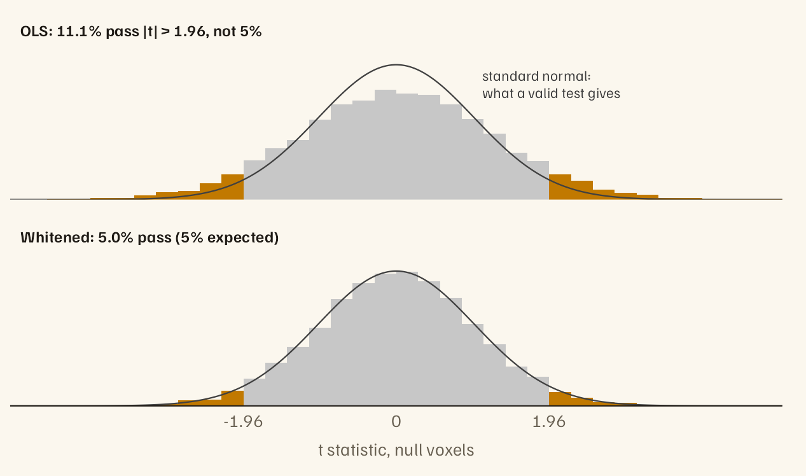

# fmriAR

<!-- badges: start -->
[](https://CRAN.R-project.org/package=fmriAR)
[](https://github.com/bbuchsbaum/fmriAR/actions/workflows/R-CMD-check.yaml)
<!-- badges: end -->

fMRI noise is autocorrelated, and ordinary least squares ignores that. Its
standard errors come out too small, so a 5% threshold passes far more than
5% of voxels with no effect. fmriAR estimates an AR or ARMA model of the
noise from the residuals of a first fit, then whitens the design matrix and
the data with the same filter, so an ordinary linear fit on the whitened
matrices gives valid standard errors.

<picture>
  <source media="(prefers-color-scheme: dark)" srcset="man/figures/README-null-t-dark.png">
   1.96 and the histogram is wider than the standard normal curve. After whitening, 5.0% pass and the histogram matches the curve." width="100%">
</picture>

*From the simulated study in `vignette("fmriAR-introduction")`: two runs,
an event-related task, AR(1) noise. Orange bars are false positives at
|t| > 1.96.*

The filtering runs in C++ (RcppArmadillo, with OpenMP when available).
Estimation respects run boundaries and censored volumes: it never pairs a
volume with one from another run or across a censored gap.

## Installation

```r
install.packages("fmriAR")

# Development version
# install.packages("remotes")
remotes::install_github("bbuchsbaum/fmriAR")
```

## Quick start

`X` is the design matrix (volumes × regressors), `Y` the data (volumes ×
voxels), and `runs` gives a run label for every volume.

```r
library(fmriAR)

# 1. Fit OLS and keep the residuals
ols <- lm.fit(X, Y)

# 2. Estimate the noise model. design = X corrects the bias that fitting
#    puts into residual autocorrelation; pass it whenever the residuals
#    come from a fitted model.
plan <- fit_noise(ols$residuals, runs = runs, design = X)

# 3. Whiten the design and the data with the same filter
w <- whiten_apply(plan, X, Y, runs = runs)

# 4. Refit, and compute standard errors on the whitened matrices
fit <- lm.fit(w$X, w$Y)
se  <- sandwich_from_whitened_resid(w$X, w$Y, beta = fit$coefficients)$se
```

`whiten(X, Y, runs = runs)` does steps 1 to 3 in one call, and corrects for
`X` on its own.

To check the result, `acorr_diagnostics()` returns each voxel's residual
autocorrelation by lag. *Getting started* shows how to compare it with the
range that white noise gives after the same fit.

**Censored volumes.** Pass volumes flagged for motion as `censor`, as
indices or a logical vector. Give the first fit one spike regressor per
flagged volume, so their values cannot reach the residuals through the
fitted coefficients. The flagged volumes are left out of the estimate, the
filter restarts after each one, and the whitened output lists them so you
can drop them before the final fit:

```r
spikes <- outer(seq_len(nrow(X)), flagged, "==") * 1
X_s  <- cbind(X, spikes)
plan <- fit_noise(lm.fit(X_s, Y)$residuals, runs = runs, design = X_s,
                  censor = flagged)
w    <- whiten_apply(plan, X, Y, runs = runs)
keep <- setdiff(seq_len(nrow(X)), w$censor)
fit  <- lm.fit(w$X[keep, ], w$Y[keep, ])
```

## What it does

- **AR models.** Yule–Walker on autocovariances pooled over voxels. With
  `p = "auto"` (the default), BIC chooses the order, counting correlated
  voxels at a smaller effective number.
- **ARMA models.** `method = "arma"` uses the Hannan–Rissanen procedure,
  pooled over voxels, refitted to the design-corrected autocovariance when
  `design` is given. AR(1) noise plus white scanner noise is ARMA(1,1). Set
  the orders yourself; the automatic ARMA search tends to pick the largest
  orders it is offered, and warns when it does.
- **Exact starts.** The first volume of each run, and of each segment after
  a censored volume, gets the exact stationary initialisation, so within
  each segment whitening is exact generalised least squares for the fitted
  noise model.
- **Pooling.** One noise model for all voxels and runs (`"global"`, the
  default), one per run (`"run"`), or one per parcel (`"parcel"`). Given
  nested parcellations, small parcels are steadied by pooling toward their
  parents, by weights that follow the evidence: parcels that genuinely differ
  keep their own estimates.
- **Design-bias correction.** Residuals carry $M \Sigma M$ rather than the
  noise covariance $\Sigma$, which biases autocorrelation downward, most of
  all with slow regressors such as drift terms. `design = X` corrects it for
  AR and ARMA models, with any pooling and with censoring, choosing a stable
  lag budget automatically. Without a design, the smaller bias from the
  estimator's own per-run centring is still corrected. `acvf_bias_matrix()`
  caches the correction for datasets that share a design, run structure and
  censoring.
- **Standard errors.** `sandwich_from_whitened_resid()` gives ordinary
  (`"iid"`), HC0, or Newey–West HAC standard errors (HAC within runs), and
  handles rank-deficient designs.
- **Autocovariances.** `noise_acvf()` returns the run- and censor-aware
  autocovariances that `fit_noise()` uses, with the number of volume pairs
  behind each lag. Plans also carry the autocovariance (`gamma`) and
  innovation variance (`sigma2`) they were fitted from.
- **AFNI-style restricted filters.** `afni_restricted_plan()` builds a plan
  from AR poles in the form used by AFNI's `1dgenARMA11` simulator (a real
  pole and complex pairs, plus an optional white-noise share `vrt`). You
  supply them; fmriAR does not estimate them.

## Learn more

Each vignette runs on simulated data with known answers, so every result can
be checked:

- [Getting started](https://bbuchsbaum.github.io/fmriAR/articles/fmriAR-introduction.html)
  (`vignette("fmriAR-introduction")`): the false-positive problem, the
  four-step workflow, and the whiteness check.
- [Refining the noise model](https://bbuchsbaum.github.io/fmriAR/articles/fmriAR-noise-models.html)
  (`vignette("fmriAR-noise-models")`): why `design = X` matters, choosing
  the AR order, robust standard errors, ARMA, and AFNI-style filters.
- [Noise that varies across the brain](https://bbuchsbaum.github.io/fmriAR/articles/fmriAR-parcels.html)
  (`vignette("fmriAR-parcels")`): per-parcel noise models and multiscale
  pooling.

Function reference: <https://bbuchsbaum.github.io/fmriAR/reference/>

## Options

- `options(fmriAR.max_threads = n)` caps the OpenMP threads used for
  whitening. OpenMP is used when the compiler supports it, and results are
  identical for any number of threads.
- `options(fmriAR.use_cpp_hr = FALSE)` switches the internal single-series
  Hannan–Rissanen helper from C++ to R. `fit_noise()` is unaffected: it uses
  the pooled estimator.

## Validation

`tools/validation/accuracy_benchmark.R`, in the source repository (not the
CRAN package), runs seeded accuracy, calibration and timing scenarios
through the exported API, so two installed versions can be compared:

```sh
Rscript tools/validation/accuracy_benchmark.R <lib_path_or_-> results.rds
```

## References

- Hannan, E. J., & Rissanen, J. (1982). Recursive estimation of mixed
  autoregressive-moving average order. *Biometrika*, 69(1), 81–94.
  <https://doi.org/10.1093/biomet/69.1.81>
- Cox, R. W. (2012). AFNI: What, where, how? *NeuroImage*, 62(2), 743–747.
  <https://doi.org/10.1016/j.neuroimage.2011.08.056>
