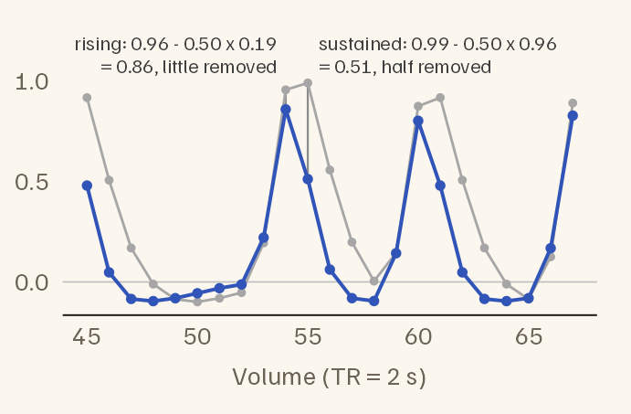
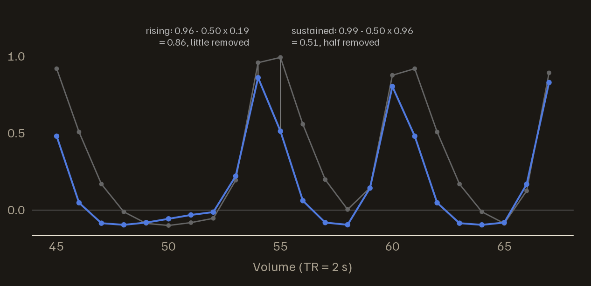
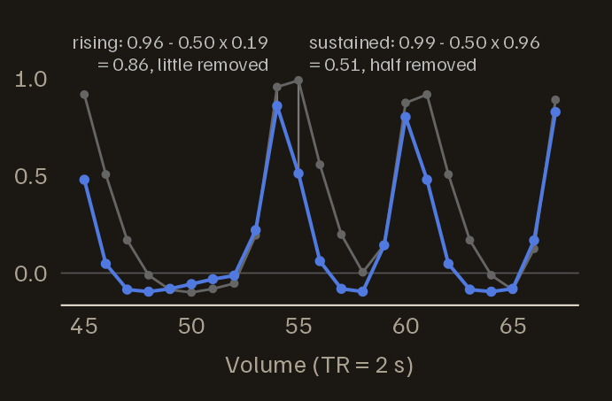
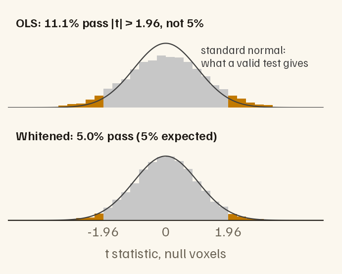
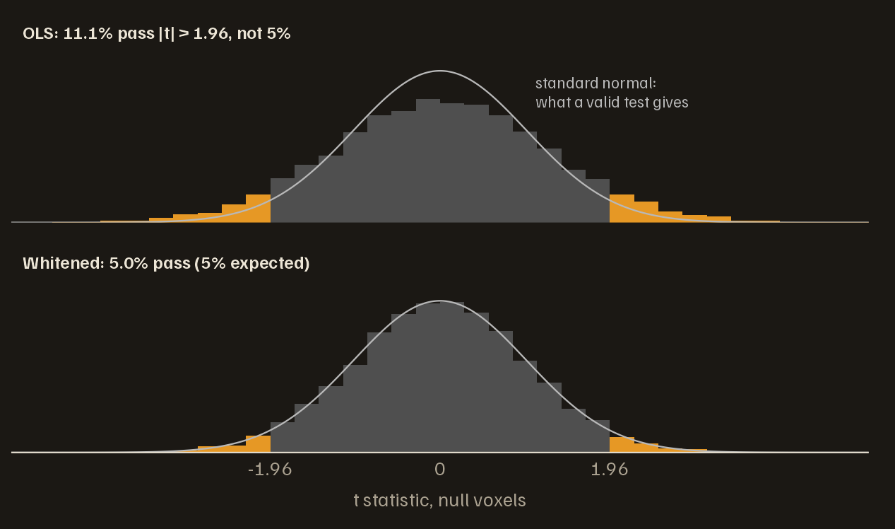
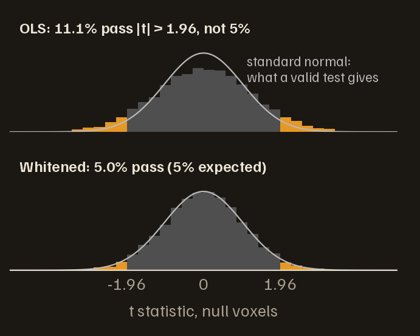
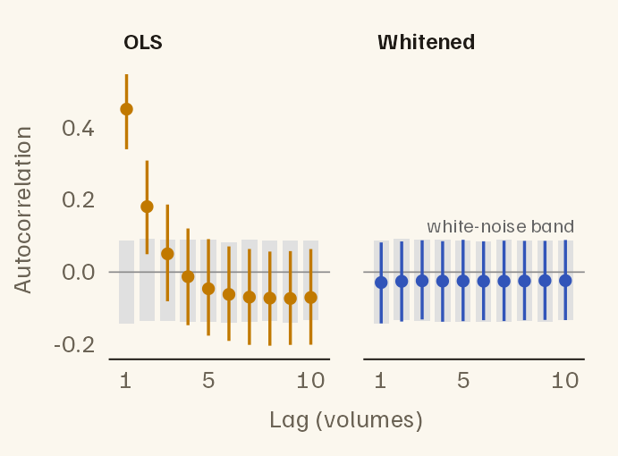
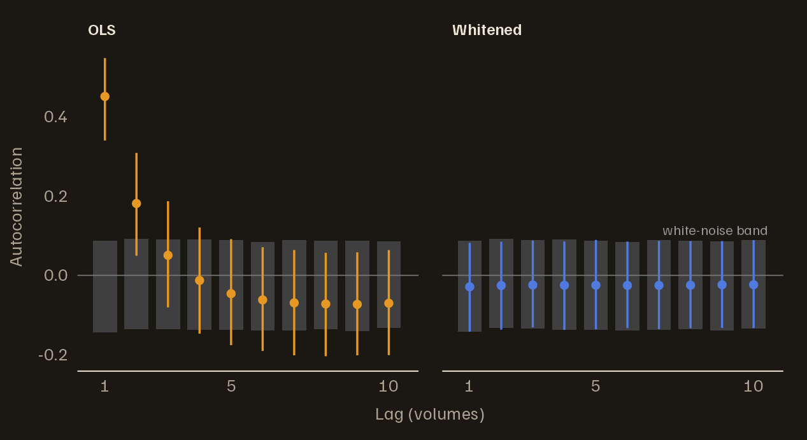
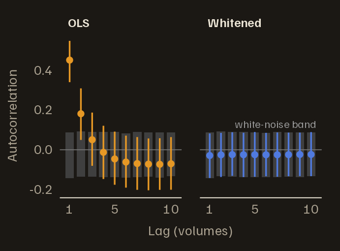

# Getting started with fmriAR

fMRI noise is autocorrelated: what the scanner records at one volume
predicts part of what it records at the next. Ordinary least squares
(OLS) ignores this. Its coefficient estimates remain unbiased, but its
standard errors come out too small. Its *t* statistics are then too
large, and a 5% threshold passes more than 5% of the voxels that have no
real effect.

Prewhitening fixes this. Estimate the autocorrelation from the residuals
of a first OLS fit, and build a filter that turns the noise into white
noise, meaning noise with no autocorrelation. Pass both the data and the
design matrix through that filter, then fit again. fmriAR does the
estimation and the filtering. This vignette works through the steps on
simulated data, where the right answers are known, so every result can
be checked.

## A simulated study

The study has two five-minute runs of 150 volumes each, at a repetition
time (TR) of 2 seconds. The task is a series of brief events 12 to 20
seconds apart, convolved with a canonical haemodynamic response. As in
most fMRI models, the design also has an intercept and three slow cosine
drift terms for each run.

``` r

library(fmriAR)
set.seed(2024)

TR <- 2
n_per_run <- 150
runs <- rep(1:2, each = n_per_run)   # a run label for every volume
n_time <- length(runs)

# Brief events 12-20 s apart, convolved with a canonical HRF
hrf <- function(t) dgamma(t, 6) - dgamma(t, 16) / 6
h <- hrf(seq(0, 30, by = TR))
event_regressor <- function(n) {
  onsets <- cumsum(sample(6:10, n, replace = TRUE))
  stim <- tabulate(onsets[onsets <= n], nbins = n)
  x <- stats::filter(stim, h / max(h), sides = 1)
  as.numeric(replace(x, is.na(x), 0))
}

# Three slow cosines per run absorb scanner drift
cosines <- function(n, k) {
  sapply(seq_len(k), function(j) cos(pi * j * (seq_len(n) - 0.5) / n))
}
none <- matrix(0, n_per_run, 3)

X <- cbind(c(event_regressor(n_per_run), event_regressor(n_per_run)),
           runs == 1, runs == 2,
           rbind(cosines(n_per_run, 3), none),
           rbind(none, cosines(n_per_run, 3)))
colnames(X) <- c("task", "run1", "run2", paste0("drift", 1:6))
```

The noise in each voxel is a first-order autoregressive process, AR(1),
with coefficient 0.5: each volume’s noise is half the previous volume’s
plus a fresh random shock. Each run is simulated separately, so no noise
carries over from one run to the next. One voxel in ten responds to the
task. The other 9,000 are *null voxels*, with no effect at all; counting
how many of them pass a threshold gives the false-positive rate.

``` r

n_vox <- 10000
active <- 1:1000
null <- setdiff(seq_len(n_vox), active)

ar1_run <- function() as.numeric(arima.sim(list(ar = 0.5), n = n_per_run))
noise <- replicate(n_vox, c(ar1_run(), ar1_run()))

beta <- ifelse(seq_len(n_vox) %in% active, 0.5, 0)
Y <- noise + outer(X[, "task"], beta)
```

## The problem: OLS on autocorrelated noise

Fit OLS to every voxel and compute a *t* statistic for the task. Given
the unwhitened design and data,
[`sandwich_from_whitened_resid()`](https://bbuchsbaum.github.io/fmriAR/reference/sandwich_from_whitened_resid.md)
returns the ordinary OLS standard errors.

``` r

ols <- lm.fit(X, Y)
se_ols <- sandwich_from_whitened_resid(X, Y, beta = ols$coefficients)$se
t_ols <- ols$coefficients["task", ] / se_ols[1, ]

# Share of null voxels that pass |t| > 1.96
mean(abs(t_ols[null]) > 1.96)
#> [1] 0.111
```

The threshold promises 5%. OLS delivers 11.1%.

## Step 1: Estimate the noise model

[`fit_noise()`](https://bbuchsbaum.github.io/fmriAR/reference/fit_noise.md)
estimates the autocorrelation from the OLS residuals and fits an
autoregressive model to it. By default it chooses the model order by the
Bayesian information criterion, BIC (`p = "auto"`), and pools all voxels
and runs into one model (`pooling = "global"`). It never pairs a volume
in one run with a volume in another.

``` r

plan <- fit_noise(ols$residuals, runs = runs, design = X)
plan
#> fmriAR whitening plan
#>   Method: AR
#>   Orders: p = 1, q = 0
#>   Pooling: global
#>   Runs: 2 (1, 2)
#>   Segment start: exact stationary
#>   Coefficients:
#>     global: phi = 0.5
```

The result is a whitening *plan*: the fitted noise model, in the form
[`whiten_apply()`](https://bbuchsbaum.github.io/fmriAR/reference/whiten_apply.md)
takes. BIC chose AR(1) and estimated its coefficient at 0.50; the truth
is 0.5.

Pass `design = X` whenever the residuals come from a fitted model.
Fitting removes some of the noise along with the effects being modelled,
so the residuals look less autocorrelated than the noise really is. The
bias grows with the size of the design, and slow regressors cause most
of it: drift terms above all, but also motion parameters. `design = X`
corrects it. Without the correction, a fit that pools thousands of
voxels can also choose an AR order that is too high;
[`fit_noise()`](https://bbuchsbaum.github.io/fmriAR/reference/fit_noise.md)
warns when its search reaches the highest order allowed. *Refining the
noise model*
([`vignette("fmriAR-noise-models")`](https://bbuchsbaum.github.io/fmriAR/articles/fmriAR-noise-models.md))
demonstrates both problems.

## Step 2: Whiten the design and the data

[`whiten_apply()`](https://bbuchsbaum.github.io/fmriAR/reference/whiten_apply.md)
runs the filter down every column of `X` and `Y`, restarting it at the
beginning of each run. It returns whitened copies and leaves your inputs
unchanged.

``` r

w <- whiten_apply(plan, X, Y, runs = runs)
```

For an AR(1), the filter is a single subtraction: each whitened value is
the original value minus 0.50 times the value one volume earlier. That
removes the part of the noise the previous volume predicts and leaves
the fresh shock. The first volume of each run has no predecessor, so
instead it is multiplied by $`\sqrt{1 - \phi^2}`$, where $`\phi`$ is the
AR coefficient. That makes the result exact generalised least squares
(GLS) for the fitted noise model.

The design must go through the same filter. The model says data = design
× coefficients + noise. Filtering both sides with the same filter leaves
the equation, and its coefficients, intact; only the noise changes, and
it becomes white.



The task regressor before (grey) and after (blue) whitening, one dot per
volume, around one event in run 1. Each blue value is the grey value
minus half the grey value one volume earlier; two volumes are worked
through. Every voxel’s data goes through the same filter.





The whitened regressor peaks one volume earlier than the original, falls
faster, and dips below zero after each response. A rising volume keeps
most of its value, a volume that repeats its predecessor loses half, and
a falling volume goes negative. Whitening keeps the changes in a signal
and discounts its slow, sustained parts, because slow fluctuations are
exactly what autocorrelated noise produces on its own.

## Step 3: Refit and compute standard errors

Fit the whitened data on the whitened design. Once the noise is white,
the ordinary standard-error formula is the right one.

``` r

gls <- lm.fit(w$X, w$Y)
se_gls <- sandwich_from_whitened_resid(w$X, w$Y, beta = gls$coefficients)$se
t_gls <- gls$coefficients["task", ] / se_gls[1, ]
```

Because the simulation records which voxels have an effect, each fit can
be scored against the truth. Over the 9,000 null voxels, the *reported*
standard error should match the *actual* spread of the estimates, and 5%
of the voxels should pass the threshold. The last two columns measure
sensitivity: the share of the 1,000 active voxels that pass at 1.96, and
the share that pass when each method’s threshold is set so that exactly
5% of its null voxels pass.

``` r

summarise_fit <- function(b, se) {
  c(`reported SE`    = mean(se[1, null]),
    `actual SD`      = sd(b["task", null]),
    `false positive` = mean(abs(b["task", null] / se[1, null]) > 1.96),
    `true positive`  = mean(abs(b["task", active] / se[1, active]) > 1.96),
    `at matched 5%`  = mean(abs(b["task", active] / se[1, active]) >
                              quantile(abs(b["task", null] / se[1, null]), 0.95)))
}
knitr::kable(
  rbind(OLS = summarise_fit(ols$coefficients, se_ols),
        whitened = summarise_fit(gls$coefficients, se_gls)),
  digits = 3,
  caption = "The task effect estimated by OLS and after prewhitening, scored against the simulation's truth."
)
```

|          | reported SE | actual SD | false positive | true positive | at matched 5% |
|:---------|------------:|----------:|---------------:|--------------:|--------------:|
| OLS      |       0.168 |     0.207 |          0.111 |         0.793 |         0.673 |
| whitened |       0.191 |     0.192 |          0.050 |         0.749 |         0.749 |

The task effect estimated by OLS and after prewhitening, scored against
the simulation’s truth. {.table}

OLS reports a standard error well below the actual spread of its
estimates, and its false-positive rate is 2.2 times the nominal 5%.
After prewhitening, reported and actual agree, and the rate is back near
5%. Whitening costs no real sensitivity. Its estimates vary less,
because GLS is the more efficient estimator, and when both methods are
held to the same 5% false-positive rate, whitening finds more of the
active voxels. OLS’s higher raw true-positive rate comes entirely from
the too-small standard error that also produced its false positives.

In relative terms, the excess grows as the threshold tightens. At 0.1%,
the kind of strict threshold that whole-brain analyses use, OLS passes 7
times the nominal rate.

``` r

rejection_rate <- function(t, alpha) mean(abs(t[null]) > qnorm(1 - alpha / 2))
alpha <- c(0.05, 0.01, 0.001)
pct <- function(x) sprintf("%.2f%%", 100 * x)
knitr::kable(
  data.frame(threshold = pct(alpha),
             OLS = pct(sapply(alpha, rejection_rate, t = t_ols)),
             whitened = pct(sapply(alpha, rejection_rate, t = t_gls))),
  align = "rrr",
  caption = "Share of null voxels declared significant at each threshold."
)
```

| threshold |    OLS | whitened |
|----------:|-------:|---------:|
|     5.00% | 11.10% |    4.96% |
|     1.00% |  3.70% |    1.11% |
|     0.10% |  0.74% |    0.12% |

Share of null voxels declared significant at each threshold. {.table}

The distribution of the null *t* statistics shows where the excess comes
from. Under OLS it is wider than the standard normal that the threshold
assumes; after whitening it matches.



The task t statistic in the 9,000 null voxels. The curve is the standard
normal distribution that a valid test assumes. Orange bars, where \|t\|
\> 1.96, are false positives.





## Step 4: The whiteness check

If the filter matches the noise, the residuals of the whitened fit are
white: a voxel’s residual at one volume says nothing about its residual
at the next.
[`acorr_diagnostics()`](https://bbuchsbaum.github.io/fmriAR/reference/acorr_diagnostics.md)
measures each voxel’s autocorrelation at lags 1, 2, …, centring each run
separately and never pairing volumes across a run boundary.

``` r

resid_w <- w$Y - w$X %*% gls$coefficients
ac_before <- acorr_diagnostics(ols$residuals, runs = runs, max_lag = 10,
                               aggregate = "none")
ac_after <- acorr_diagnostics(resid_w, runs = runs, max_lag = 10,
                              aggregate = "none")
```

What should white residuals look like?
[`acorr_diagnostics()`](https://bbuchsbaum.github.io/fmriAR/reference/acorr_diagnostics.md)
returns `ci`, $`1.96 / \sqrt{n}`$ for $`n`$ volumes: the textbook range
that holds 95% of a white-noise series’ autocorrelations. Residuals of a
fitted model are not quite that, though. Fitting pulls their
autocorrelations slightly below zero, more so the more regressors each
run has. The exact reference is easy to get: put pure white noise
through the same fit and see where its autocorrelations fall. That range
is the *white-noise band*.

``` r

white <- matrix(rnorm(n_time * 2000), n_time)
ac_white <- acorr_diagnostics(qr.resid(qr(w$X), white), runs = runs,
                              max_lag = 10, aggregate = "none")
band <- apply(ac_white$acf, 1, quantile, probs = c(0.025, 0.975))

# Share of voxels whose lag-1 autocorrelation falls outside the band
outside <- function(ac) mean(ac$acf[1, ] < band[1, 1] | ac$acf[1, ] > band[2, 1])
c(before = outside(ac_before), after = outside(ac_after))
#> before  after 
#>  1.000  0.047
```

The band describes one voxel, so compare it with the spread of
autocorrelations across voxels, not with their average, which varies far
less. Before whitening, every voxel’s lag-1 autocorrelation lies outside
the band. After whitening, 4.7% do: what white noise gives.



Autocorrelation of each voxel’s residuals at lags 1 to 10, after OLS
(left) and after whitening (right). Lines span the middle 95% of the
10,000 voxels; dots mark the median. Grey boxes are the white-noise
band: where 95% of the values fall for white noise put through the same
fit.





The whitened autocorrelations centre slightly below zero, at about
-0.03, and so does the band: that offset comes from fitting the model,
not from the noise. Against the textbook range $`\pm`$`ci`, which
ignores it, about 8% of whitened voxels would look like failures at
lag 1. The OLS residuals at lags 5 to 10 are also negative, for the same
reason.

If some autocorrelation remains, for example because the AR order was
too low, `sandwich_from_whitened_resid(..., type = "hac", runs = runs)`
gives standard errors that tolerate it (Newey–West, computed within
runs).

## Common situations

### Several runs

`pooling = "global"` (the default) fits one noise model to all runs.
`pooling = "run"` gives each run its own coefficients, for runs whose
noise may differ, such as runs from different sessions or sequences.

``` r

plan_by_run <- fit_noise(ols$residuals, runs = runs, design = X,
                         pooling = "run")
plan_by_run$phi
#> $`1`
#> [1] 0.4997175
#> 
#> $`2`
#> [1] 0.5012036
```

### Censored volumes

Pass volumes flagged for motion (scrubbed volumes) as `censor`, either
as indices or as a logical vector with one entry per volume. They are
left out of the noise estimate, and the filter restarts after each one
so that no flagged value leaks into its neighbours.

Censoring the noise estimate is not enough on its own, though: the first
OLS fit still sees the flagged volumes, and a large artefact there
shifts the fitted coefficients and so every residual. Give the first fit
one spike regressor per flagged volume, which makes their residuals
exactly zero, and pass that design to
[`fit_noise()`](https://bbuchsbaum.github.io/fmriAR/reference/fit_noise.md).
The whitened output keeps every row and lists the censored rows in
`censor`; drop them before the final fit, which needs no spike
regressors.

``` r

scrub <- c(50:52, 170)
spikes <- outer(seq_len(n_time), scrub, "==") * 1   # one column per volume
X_s <- cbind(X, spikes)

plan_c <- fit_noise(lm.fit(X_s, Y)$residuals, runs = runs, design = X_s,
                    censor = scrub)
w_c <- whiten_apply(plan_c, X, Y, runs = runs)

keep <- setdiff(seq_len(n_time), w_c$censor)
fit_c <- lm.fit(w_c$X[keep, ], w_c$Y[keep, ])
```

[`whiten_apply()`](https://bbuchsbaum.github.io/fmriAR/reference/whiten_apply.md)
reuses the plan’s censored volumes when the data have the length the
plan was fitted on, as here; otherwise pass `censor` yourself.

### One call

[`whiten()`](https://bbuchsbaum.github.io/fmriAR/reference/whiten.md)
fits the OLS model, estimates the noise model and whitens, all in one
step. It corrects for `X` itself, since it formed the residuals from it.
Other arguments after `censor` go to
[`fit_noise()`](https://bbuchsbaum.github.io/fmriAR/reference/fit_noise.md).

``` r

w1 <- whiten(X, Y, runs = runs)
```

### Large data

Whitening runs in parallel over voxels when fmriAR is built with OpenMP.
`options(fmriAR.max_threads = k)` caps the number of threads.

## Where next

- *Refining the noise model*
  ([`vignette("fmriAR-noise-models")`](https://bbuchsbaum.github.io/fmriAR/articles/fmriAR-noise-models.md)):
  why `design = X` matters, choosing the AR order, robust standard
  errors, ARMA models, and AFNI-style restricted models.
- *Noise that varies across the brain*
  ([`vignette("fmriAR-parcels")`](https://bbuchsbaum.github.io/fmriAR/articles/fmriAR-parcels.md)):
  separate noise models for parcels, steadied by pooling across spatial
  scales.
