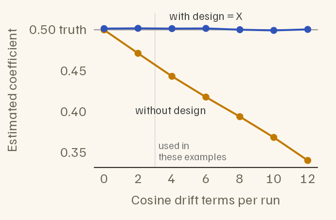
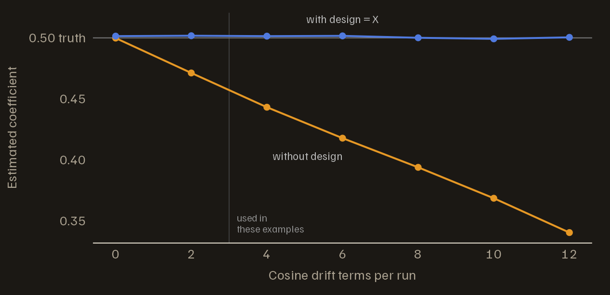
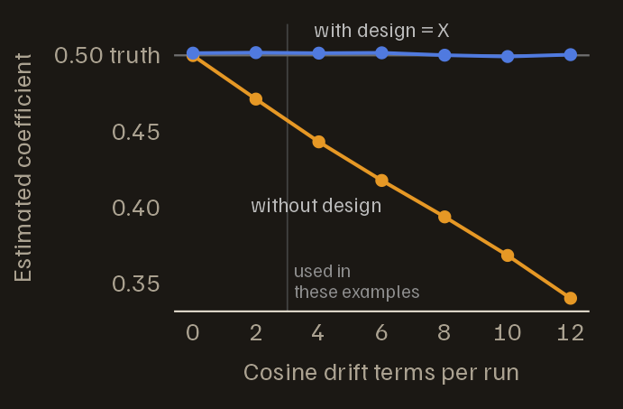
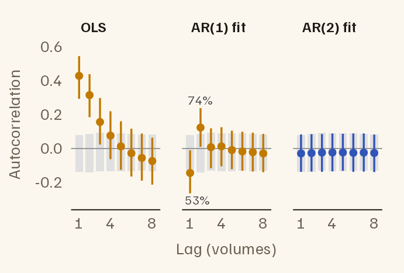
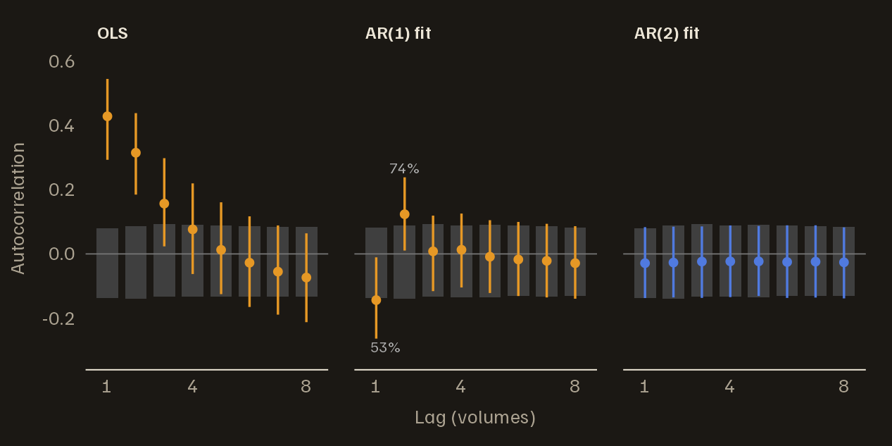
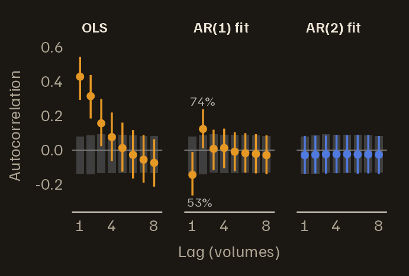

# Refining the noise model

*Getting started*
([`vignette("fmriAR-introduction")`](https://bbuchsbaum.github.io/fmriAR/articles/fmriAR-introduction.md))
ran the default workflow on noise that matched its assumptions. This
vignette covers the choices behind that workflow: why to pass the design
to
[`fit_noise()`](https://bbuchsbaum.github.io/fmriAR/reference/fit_noise.md),
how the AR order is chosen and how to tell when it is too low, standard
errors that tolerate leftover autocorrelation, when an ARMA model fits
better, and how to use filters specified in AFNI’s restricted form.

The examples use the same kind of simulated study as *Getting started*:
two runs of 150 volumes at a TR of 2 seconds, an event-related task, and
an intercept and a set of cosine drift terms for each run. Each section
changes the noise; the first also varies the number of drift terms.

``` r

library(fmriAR)
set.seed(7)

TR <- 2
n_per_run <- 150
runs <- rep(1:2, each = n_per_run)
n_time <- length(runs)

hrf <- function(t) dgamma(t, 6) - dgamma(t, 16) / 6
h <- hrf(seq(0, 30, by = TR))
event_regressor <- function(n) {
  onsets <- cumsum(sample(6:10, n, replace = TRUE))
  stim <- tabulate(onsets[onsets <= n], nbins = n)
  x <- stats::filter(stim, h / max(h), sides = 1)
  as.numeric(replace(x, is.na(x), 0))
}
cosines <- function(n, k) {
  sapply(seq_len(k), function(j) cos(pi * j * (seq_len(n) - 0.5) / n))
}

# Task, one intercept per run, and k cosine drift terms per run
make_design <- function(k = 3) {
  X <- cbind(task = c(event_regressor(n_per_run), event_regressor(n_per_run)),
             run1 = runs == 1, run2 = runs == 2)
  if (k > 0) {
    none <- matrix(0, n_per_run, k)
    X <- cbind(X, rbind(cosines(n_per_run, k), none),
                  rbind(none, cosines(n_per_run, k)))
  }
  X
}

# Noise for n_vox voxels, each run simulated separately: an AR process with
# coefficients `ar`, plus optional white noise with standard deviation white_sd
simulate_noise <- function(n_vox, ar, white_sd = 0) {
  one_run <- function() {
    as.numeric(arima.sim(list(ar = ar), n = n_per_run)) +
      rnorm(n_per_run, sd = white_sd)
  }
  replicate(n_vox, c(one_run(), one_run()))
}
```

## Why `design = X` matters

The noise model is estimated from residuals, and residuals are not the
noise. Fitting a model removes from the data whatever the regressors can
reproduce, and that includes some of the noise. In matrix terms the
residuals are $`My`$, where $`M = I - X(X^\top X)^{-1}X^\top`$ is the
projection that removes the design, so their covariance is
$`M \Sigma M`$ rather than the noise covariance $`\Sigma`$.

The result is a downward bias in the estimated autocorrelation, and
drift terms cause most of it: slow cosines soak up slow fluctuations,
which is where autocorrelated noise keeps its power. Below, the same
AR(1) noise, with coefficient 0.5, is fitted under designs with more and
more drift terms, once without the design (`plain`) and once with it
(`corrected`).

``` r

noise <- simulate_noise(2000, ar = 0.5)

n_drift <- c(0, 2, 4, 6, 8, 10, 12)
bias <- t(sapply(n_drift, function(k) {
  X_k <- make_design(k)
  r <- lm.fit(X_k, noise)$residuals
  c(drift_terms = k,
    plain = fit_noise(r, runs = runs, p = 1)$phi[[1]],
    corrected = fit_noise(r, runs = runs, p = 1, design = X_k)$phi[[1]])
}))
round(bias, 3)
#>      drift_terms plain corrected
#> [1,]           0 0.500     0.501
#> [2,]           2 0.471     0.502
#> [3,]           4 0.443     0.501
#> [4,]           6 0.418     0.502
#> [5,]           8 0.394     0.500
#> [6,]          10 0.369     0.499
#> [7,]          12 0.341     0.500
```



Estimated AR(1) coefficient as drift terms are added to the design. The
noise is the same throughout, and its true coefficient is 0.5. Without
the design, the estimate falls steadily; with design = X, it stays at
the truth. The examples in these vignettes use 3 drift terms per run.





`design = X` corrects for the projection:
[`fit_noise()`](https://bbuchsbaum.github.io/fmriAR/reference/fit_noise.md)
works out the bias that $`M`$ puts into each lag of the autocovariance
and inverts it. The correction works with every pooling mode, for AR and
ARMA models, and with censoring. It needs residuals that really are OLS
residuals from `X`; a numerical check rejects obvious mismatches.
[`whiten()`](https://bbuchsbaum.github.io/fmriAR/reference/whiten.md)
and `fit_noise(Y = , X = )` form the residuals themselves and pass the
design on their own. Without a design,
[`fit_noise()`](https://bbuchsbaum.github.io/fmriAR/reference/fit_noise.md)
still corrects the smaller bias its own per-run centring introduces.

The correction is computed up to a lag budget and assumes the noise
autocovariance has died out by then. The default,
`correction_max_lag = "auto"`, starts at 25 lags and shortens the budget
when the design makes a long one unstable, as many drift terms do. With
12 cosines per run, a 50-second high-pass filter far stricter than the
usual 128 seconds, it still recovers the truth:

``` r

X_12 <- make_design(12)
r_12 <- lm.fit(X_12, noise)$residuals
fit_noise(r_12, runs = runs, p = 1, design = X_12)$phi[[1]]
#> [1] 0.5005905
```

A budget you set yourself is shortened the same way, with a warning. If
the fitted noise is still clearly autocorrelated at the end of the
budget, where the correction becomes partial,
[`fit_noise()`](https://bbuchsbaum.github.io/fmriAR/reference/fit_noise.md)
warns about that too.

Two helpers expose the same correction. `noise_acvf(resid, design = X)`
returns the corrected autocovariance itself.
[`acvf_bias_matrix()`](https://bbuchsbaum.github.io/fmriAR/reference/acvf_bias_matrix.md)
builds the correction once, so that it can be passed to
`fit_noise(acvf_correction = )` for many datasets that share the same
design, run structure and censored volumes.

## Choosing the AR order

With `p = "auto"` (the default),
[`fit_noise()`](https://bbuchsbaum.github.io/fmriAR/reference/fit_noise.md)
tries every order from 0 to `p_max` (default 6) and keeps the one with
the lowest Bayesian information criterion (BIC). Pooling many voxels
gives BIC more evidence than one series would. But neighbouring voxels
share fluctuations, so
[`fit_noise()`](https://bbuchsbaum.github.io/fmriAR/reference/fit_noise.md)
counts them as an effective number of independent voxels,
$`V / (1 + (V - 1)\bar r)`$ for $`V`$ voxels with mean inter-voxel
correlation $`\bar r`$. That count is deliberately conservative.

The design correction matters here too. Projection bias distorts every
lag a little, and with thousands of voxels BIC treats those small,
systematic distortions as structure worth extra coefficients. Here the
noise is AR(2):

``` r

X <- make_design(3)
noise_ar2 <- simulate_noise(2000, ar = c(0.4, 0.2))
r_ar2 <- lm.fit(X, noise_ar2)$residuals

plan_nodesign <- fit_noise(r_ar2, runs = runs)
#> ⁤Warning: fit_noise(): BIC chose the largest AR order allowed (p_max = 6).
#> ⁤Residuals from a fitted model carry a small autocorrelation from the fit
#> ⁤itself, and with many voxels pooled BIC can mistake it for real structure. If
#> ⁤'resid' came from a regression, pass that design matrix as 'design'; otherwise
#> ⁤consider a larger 'p_max'.
plan_design <- fit_noise(r_ar2, runs = runs, design = X)
c(without_design = plan_nodesign$order[["p"]],
  with_design = plan_design$order[["p"]])
#> without_design    with_design 
#>              6              2
```

With the design, the search finds AR(2). Without it, the search chooses
AR(6), adding 4 coefficients that describe the projection, not the
noise, and
[`fit_noise()`](https://bbuchsbaum.github.io/fmriAR/reference/fit_noise.md)
warns that the search reached its ceiling.

### Spotting an order that is too low

The whiteness check from *Getting started* shows when an order is too
low. Here it is as two functions: `whitened()` refits a noise model’s
whitened data and returns the residuals with the whitened design, and
`whiteness()` compares each voxel’s autocorrelations with the
white-noise band for that design, built by passing pure white noise
through the same fit.

``` r

white <- matrix(rnorm(n_time * 2000), n_time)

whitened <- function(plan, Y) {
  w <- whiten_apply(plan, X, Y, runs = runs)
  list(resid = w$Y - w$X %*% qr.coef(qr(w$X), w$Y), design = w$X)
}
whiteness <- function(resid, design, max_lag = 8) {
  ac <- acorr_diagnostics(resid, runs = runs, max_lag = max_lag,
                          aggregate = "none")$acf
  ref <- acorr_diagnostics(qr.resid(qr(design), white), runs = runs,
                           max_lag = max_lag, aggregate = "none")$acf
  band <- apply(ref, 1, quantile, probs = c(0.025, 0.975))
  list(ac = ac, band = band,
       outside = rowMeans(ac < band[1, ] | ac > band[2, ]))   # share per lag
}
```

Below, the same AR(2) noise is whitened twice: with an AR(1) model, and
with the AR(2) model the search chose.

``` r

plan_ar1 <- fit_noise(r_ar2, runs = runs, p = 1, design = X)
plan_ar2 <- fit_noise(r_ar2, runs = runs, design = X)
w_ar1 <- whitened(plan_ar1, noise_ar2)
w_ar2 <- whitened(plan_ar2, noise_ar2)

# The order chosen without the design correction, for comparison
w_nod <- whitened(plan_nodesign, noise_ar2)

# Share of voxels outside the band at lags 1 to 3
round(rbind(
  `AR(1) fit` = whiteness(w_ar1$resid, w_ar1$design)$outside[1:3],
  `AR(2) fit` = whiteness(w_ar2$resid, w_ar2$design)$outside[1:3],
  `AR(6), no design` = whiteness(w_nod$resid, w_nod$design)$outside[1:3]
), 3)
#>                   [,1]  [,2]  [,3]
#> AR(1) fit        0.534 0.740 0.084
#> AR(2) fit        0.054 0.043 0.046
#> AR(6), no design 0.103 0.071 0.068
```

White noise leaves 5% outside; with 2,000 voxels, chance moves that
share by about 1.5 points either way. The AR(1) filter fails at lags 1
and 2: it overshoots at lag 1, turning a strong positive autocorrelation
negative, and leaves a positive one at lag 2. The AR(2) filter passes.
The AR(6) filter chosen without the design correction fails too, more
mildly: its extra coefficients fit the projection’s distortion, and
whitening with them leaves autocorrelation behind.



The whiteness check for AR(2) noise: residual autocorrelation after OLS,
after an AR(1) filter and after an AR(2) filter. Lines span the middle
95% of voxels; dots mark the median; grey boxes are the white-noise band
for each fit. The AR(1) filter fails at lags 1 and 2, where the
percentages give the share of voxels outside the band; the AR(2) filter
passes.





## Robust standard errors

By default (`type = "iid"`),
[`sandwich_from_whitened_resid()`](https://bbuchsbaum.github.io/fmriAR/reference/sandwich_from_whitened_resid.md)
returns the ordinary standard error, which assumes the whitened noise is
white. When some autocorrelation survives whitening, that standard error
is off again, in a direction that depends on what was missed.
`type = "hac"` gives a heteroskedasticity- and
autocorrelation-consistent (HAC) Newey–West estimator, computed within
runs, which allows for leftover autocorrelation at short lags.
`type = "hc0"` allows for unequal variances only.

The AR(2) noise above has no task effect, so every voxel is null and 5%
of them should pass $`|t| > 1.96`$:

``` r

false_positive_rate <- function(plan, type) {
  w <- whiten_apply(plan, X, noise_ar2, runs = runs)
  fit <- lm.fit(w$X, w$Y)
  se <- sandwich_from_whitened_resid(w$X, w$Y, beta = fit$coefficients,
                                     type = type, runs = runs)$se
  mean(abs(fit$coefficients["task", ] / se[1, ]) > 1.96)
}
rates <- sapply(c("iid", "hac"), function(type) {
  c(`AR(1), too low` = false_positive_rate(plan_ar1, type),
    `AR(2), correct` = false_positive_rate(plan_ar2, type))
})
knitr::kable(rates, digits = 3,
             caption = "Share of null voxels with |t| > 1.96, by noise model and standard error.")
```

|                |   iid |   hac |
|:---------------|------:|------:|
| AR(1), too low | 0.028 | 0.046 |
| AR(2), correct | 0.056 | 0.060 |

Share of null voxels with \|t\| \> 1.96, by noise model and standard
error. {.table}

With the AR(1) model, the ordinary standard error is wrong. Here it errs
on the cautious side; other misfits make it err the other way. HAC
brings the rate back toward 5%, and with the correct AR(2) model the two
agree. Use HAC as a safety net when a noise model cannot pass the
whiteness check, not as a substitute for a good noise model. It has no
small-sample correction, so in short runs it is approximate.

## ARMA models

Scanner noise adds white noise on top of the autocorrelated
physiological noise. An AR(1) process plus white noise is no longer
AR(1): it is ARMA(1,1), with one autoregressive and one moving-average
coefficient. A pure AR model can mimic it only with extra coefficients.
Below, the noise is AR(1) with coefficient 0.8 plus white noise.

``` r

noise_mix <- simulate_noise(2000, ar = 0.8, white_sd = 1)
r_mix <- lm.fit(X, noise_mix)$residuals

plan_ar_auto <- fit_noise(r_mix, runs = runs, design = X)
plan_arma <- fit_noise(r_mix, runs = runs, method = "arma", p = 1, q = 1,
                       design = X)

plan_ar_auto$order
#> p q 
#> 5 0
plan_arma
#> fmriAR whitening plan
#>   Method: ARMA
#>   Orders: p = 1, q = 1
#>   Pooling: global
#>   Runs: 2 (1, 2)
#>   Segment start: exact stationary
#>   Coefficients:
#>     global: phi = 0.801; theta = -0.342
```

ARMA models are first estimated by the Hannan–Rissanen procedure, pooled
over voxels: each voxel is a replicate series sharing the coefficients,
and no lag crosses a run boundary or a censored volume (`hr_iter` adds
refinement iterations). That procedure works on the residual series, so
it inherits the projection bias; with `design`, the coefficients are
then refitted to the design-corrected autocovariance. Here they come out
at 0.80 and -0.34; the truth is 0.8 and about -0.34.

The BIC search picked AR(5); ARMA(1,1) describes the same noise with two
coefficients. The table scores each model by the share of voxels outside
the white-noise band at lags 1 to 3 (white noise leaves 5%) and by the
false-positive rate, along with a plain AR(1) and an ARMA(1,1) fitted
without the design, for comparison.

``` r

score <- function(plan) {
  wh <- whitened(plan, noise_mix)
  w <- whiten_apply(plan, X, noise_mix, runs = runs)
  fit <- lm.fit(w$X, w$Y)
  se <- sandwich_from_whitened_resid(w$X, w$Y, beta = fit$coefficients)$se
  c(whiteness(wh$resid, wh$design, max_lag = 3)$outside,
    mean(abs(fit$coefficients["task", ] / se[1, ]) > 1.96))
}
plan_ar1_mix <- fit_noise(r_mix, runs = runs, p = 1, design = X)
plan_arma_nod <- fit_noise(r_mix, runs = runs, method = "arma", p = 1, q = 1)
tab <- rbind(`AR(1)` = score(plan_ar1_mix),
             `AR, order by BIC` = score(plan_ar_auto),
             `ARMA(1,1), no design` = score(plan_arma_nod),
             `ARMA(1,1)` = score(plan_arma))
colnames(tab) <- c("outside, lag 1", "lag 2", "lag 3", "false positive")
knitr::kable(tab, digits = 3,
             caption = "Share of voxels outside the white-noise band, and false-positive rate, for AR(1) noise plus white noise.")
```

|                      | outside, lag 1 | lag 2 | lag 3 | false positive |
|:---------------------|---------------:|------:|------:|---------------:|
| AR(1)                |          0.670 | 0.338 | 0.196 |           0.03 |
| AR, order by BIC     |          0.061 | 0.044 | 0.046 |           0.06 |
| ARMA(1,1), no design |          0.173 | 0.089 | 0.055 |           0.06 |
| ARMA(1,1)            |          0.060 | 0.046 | 0.046 |           0.06 |

Share of voxels outside the white-noise band, and false-positive rate,
for AR(1) noise plus white noise. {.table}

The AR(1) fails clearly, and its tests are conservative. The
design-corrected AR and ARMA(1,1) models both pass. Without the design,
the ARMA(1,1) coefficients carry the projection bias, and the filter
leaves 17% of voxels outside the band at lag 1.

`method = "arma"` also accepts `p = "auto"` and `q = "auto"`, which
search `0:p_max` and `0:q_max` by BIC. Do not rely on that search:

``` r

rbind(
  residuals = fit_noise(r_mix, runs = runs, method = "arma",
                        p = "auto", q = "auto")$order,
  noise_itself = fit_noise(noise_mix, runs = runs, method = "arma",
                           p = "auto", q = "auto")$order
)
#> ⁤Warning: fit_noise(): the ARMA order search chose the largest order allowed
#> ⁤(p_max = 6). Its BIC is computed on a regression with estimated innovations,
#> ⁤and with many voxels pooled the approximation error looks like structure. Set
#> ⁤'p' and 'q' explicitly.
#>              p q
#> residuals    6 2
#> noise_itself 2 2
```

On the residuals it returns the largest orders it is allowed. On the
noise itself, with no fitted model in the way, it still returns more
coefficients than the ARMA(1,1) truth. The BIC is computed on a
regression that uses estimated innovations, and with hundreds of
thousands of observations the error in that approximation looks like
structure. Set the orders.

## AFNI-style restricted filters

AFNI specifies some noise models by their poles rather than their
coefficients: an AR(3) with one real pole `a` and one complex pair
(radius `r1`, angle `t1`), or an AR(5) with a second pair (`r2`, `t2`),
plus an optional share of white noise. The poles are reciprocal roots of
the AR polynomial, so values below 1 mean a stationary process. AFNI’s
`1dgenARMA11` uses this form to simulate noise.
[`afni_restricted_plan()`](https://bbuchsbaum.github.io/fmriAR/reference/afni_restricted_plan.md)
turns such a specification into an ordinary plan that
[`whiten_apply()`](https://bbuchsbaum.github.io/fmriAR/reference/whiten_apply.md)
can use. It does not estimate the poles; you supply them. The residuals
passed to it set the run structure and, with `estimate_ma1 = TRUE`, the
MA term; with `estimate_ma1 = FALSE` their values are not used.

``` r

roots <- list(a = 0.5, r1 = 0.4, t1 = pi / 3)
plan_afni <- afni_restricted_plan(r_ar2, runs = runs, p = 3L, roots = roots,
                                  estimate_ma1 = FALSE)
round(plan_afni$phi[[1]], 3)
#> [1]  0.90 -0.36  0.08
```

`a`, `r1` and `r2` must be non-negative; values above 0.95 are clamped
to 0.95, and angles are clamped to $`[0, \pi]`$. The white noise is set
by `vrt`, the share of variance carried by the AR part. With `vrt` below
1 and `estimate_ma1 = FALSE`, the plan is the exact ARMA(p, p)
equivalent of AR(p) plus white noise: its autocorrelation is `vrt` times
the AR autocorrelation at every nonzero lag.

``` r

plan_afni_vrt <- afni_restricted_plan(r_ar2, runs = runs, p = 3L,
                                      roots = c(roots, vrt = 0.8),
                                      estimate_ma1 = FALSE)
plan_afni_vrt$order
#> p q 
#> 3 3
```

With `estimate_ma1 = TRUE` (the default), the poles fix the AR part, an
MA(1) term is estimated from the AR-filtered residuals, and `vrt` is
ignored. To give each parcel its own filter, pass `parcels` and a list
of pole specifications keyed by parcel ID.
