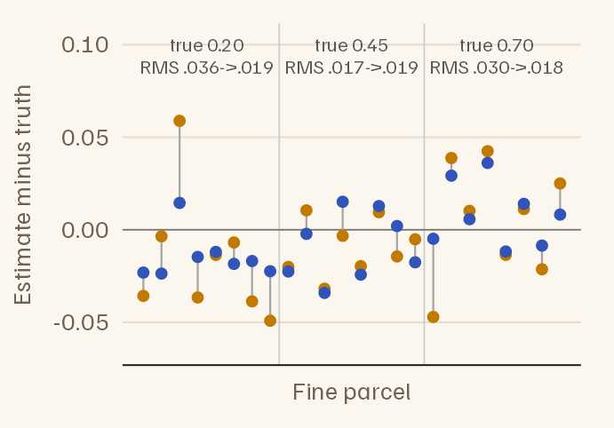
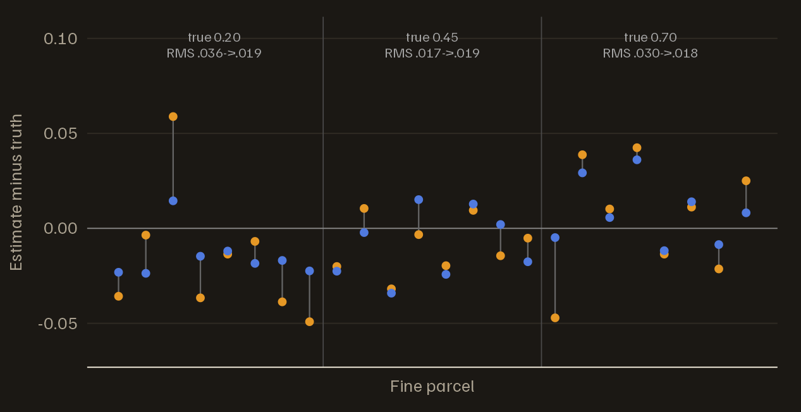
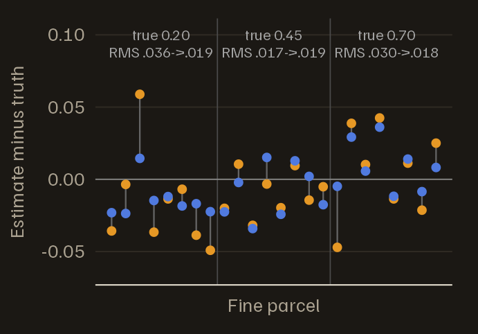

# Noise that varies across the brain

Noise is not equally autocorrelated everywhere. Voxels near large
vessels and ventricles, where cardiac and respiratory fluctuations are
strongest, usually show more autocorrelation than voxels deep in grey
matter. A single noise model for the whole brain then removes too little
autocorrelation in some regions and too much in others, and the
false-positive rate moves away from 5%: up in the first, down in the
second.

fmriAR can fit a separate noise model for each parcel of a parcellation,
and can steady the estimates for small parcels by borrowing from the
larger parcels that contain them. This vignette shows both. It assumes
you have read *Getting started*
([`vignette("fmriAR-introduction")`](https://bbuchsbaum.github.io/fmriAR/articles/fmriAR-introduction.md)).

``` r

library(fmriAR)
set.seed(9)

TR <- 2
n_per_run <- 150
runs <- rep(1:2, each = n_per_run)

hrf <- function(t) dgamma(t, 6) - dgamma(t, 16) / 6
h <- hrf(seq(0, 30, by = TR))
event_regressor <- function(n) {
  onsets <- cumsum(sample(6:10, n, replace = TRUE))
  stim <- tabulate(onsets[onsets <= n], nbins = n)
  x <- stats::filter(stim, h / max(h), sides = 1)
  as.numeric(replace(x, is.na(x), 0))
}
cosines <- function(n, k) {
  sapply(seq_len(k), function(j) cos(pi * j * (seq_len(n) - 0.5) / n))
}
none <- matrix(0, n_per_run, 3)
X <- cbind(c(event_regressor(n_per_run), event_regressor(n_per_run)),
           runs == 1, runs == 2,
           rbind(cosines(n_per_run, 3), none),
           rbind(none, cosines(n_per_run, 3)))
colnames(X) <- c("task", "run1", "run2", paste0("drift", 1:6))

# AR(1) noise for one voxel with coefficient phi, each run simulated separately
ar1_voxel <- function(phi) {
  c(arima.sim(list(ar = phi), n = n_per_run),
    arima.sim(list(ar = phi), n = n_per_run))
}
```

## One model or one per region

The simulation has three regions of 1,500 voxels each, with AR(1)
coefficients of 0.2, 0.45 and 0.7. Every voxel is null, so every
significant voxel is a false positive.

``` r

region_phi <- c(0.2, 0.45, 0.7)
region <- rep(1:3, each = 1500)
Y <- sapply(region_phi[region], ar1_voxel)
resid <- lm.fit(X, Y)$residuals
```

By default,
[`fit_noise()`](https://bbuchsbaum.github.io/fmriAR/reference/fit_noise.md)
fits one noise model to all voxels. To fit one per region, pass
`pooling = "parcel"` and a parcel label for every voxel.

``` r

plan_global <- fit_noise(resid, runs = runs, design = X)
plan_region <- fit_noise(resid, runs = runs, design = X, pooling = "parcel",
                         parcels = region)

plan_global$phi[[1]]
#> [1] 0.473519485 0.041578507 0.020037256 0.009375271 0.004987207 0.004013168
unlist(plan_region$phi_by_parcel)
#>         1         2         3 
#> 0.2009165 0.4494387 0.6982622
```

Each region’s estimate matches its truth. A mixture of three AR(1)
processes is not itself an AR(1), so the global search settles on a
longer model whose first coefficient lies between the three.

With a noise model per parcel,
[`whiten_apply()`](https://bbuchsbaum.github.io/fmriAR/reference/whiten_apply.md)
uses the parcel labels stored on the plan, or the ones you pass. It
returns one whitened design per parcel in `X_by`, keyed by parcel ID.
The data are whitened voxel by voxel, so `Y` keeps its shape. Fit each
parcel’s voxels with that parcel’s design:

``` r

task_t <- function(plan, parcels = NULL) {
  w <- whiten_apply(plan, X, Y, runs = runs, parcels = parcels)
  # A global plan gives one whitened design; a parcel plan gives one per parcel
  designs <- if (is.null(w$X_by)) list(all = w$X) else w$X_by
  t <- numeric(ncol(Y))
  for (id in names(designs)) {
    cols <- if (id == "all") seq_len(ncol(Y)) else which(parcels == id)
    Xw <- designs[[id]]
    Yw <- w$Y[, cols, drop = FALSE]
    fit <- lm.fit(Xw, Yw)
    se <- sandwich_from_whitened_resid(Xw, Yw, beta = fit$coefficients)$se
    t[cols] <- fit$coefficients["task", ] / se[1, ]
  }
  t
}

fp_rate <- rbind(
  global = tapply(abs(task_t(plan_global)) > 1.96, region, mean),
  `per region` = tapply(abs(task_t(plan_region, region)) > 1.96, region, mean)
)
colnames(fp_rate) <- sprintf("AR %.2f", region_phi)
knitr::kable(fp_rate, digits = 3,
             caption = "False-positive rate by region, at a nominal 5%.")
```

|            | AR 0.20 | AR 0.45 | AR 0.70 |
|:-----------|--------:|--------:|--------:|
| global     |   0.029 |   0.047 |   0.072 |
| per region |   0.049 |   0.038 |   0.053 |

False-positive rate by region, at a nominal 5%. {.table}

The global model is a compromise between the three regions. It removes
too much autocorrelation from the least autocorrelated region, whose
tests become conservative, and too little from the most autocorrelated,
whose false-positive rate rises above 5%. Separate models bring the two
outer regions back to about 5%. The middle region, which the global
model already suited, moves only by chance: with 1,500 voxels, a
false-positive rate is uncertain by about one percentage point either
way.

## Small parcels and multiscale pooling

Fine parcellations have small parcels, and an estimate from a few voxels
is imprecise. Multiscale pooling steadies it. You supply the
parcellation at three nested scales, and each fine parcel’s estimate is
combined with the estimates of the medium and coarse parcels that
contain it.

Here 24 fine parcels of 4 voxels each sit inside 6 medium parcels, which
sit inside 3 regions of 32 voxels with the same coefficients as before.
Each fine parcel’s true coefficient is its region’s plus a small
parcel-specific deviation (standard deviation 0.03).

``` r

fine <- rep(1:24, each = 4)          # fine parcel of each voxel
medium <- (fine - 1) %/% 4 + 1       # 4 fine parcels per medium parcel
coarse <- (fine - 1) %/% 8 + 1       # 8 fine parcels per region
phi_fine <- region_phi[(1:24 - 1) %/% 8 + 1] + rnorm(24, sd = 0.03)

Y_small <- sapply(phi_fine[fine], ar1_voxel)
resid_small <- lm.fit(X, Y_small)$residuals

plan_fine <- fit_noise(resid_small, runs = runs, design = X, p = 1,
                       pooling = "parcel", parcels = fine)
plan_multi <- fit_noise(resid_small, runs = runs, design = X, p = 1,
                        pooling = "parcel", parcels = fine,
                        parcel_sets = list(fine = fine, medium = medium,
                                           coarse = coarse))
```

``` r

est <- data.frame(
  parcel = 1:24,
  truth = phi_fine,
  `fine only` = sapply(plan_fine$phi_by_parcel, `[`, 1),
  multiscale = sapply(plan_multi$phi_by_parcel, `[`, 1),
  check.names = FALSE
)
est$region <- coarse[match(est$parcel, fine)]
rms_error <- function(d) {
  c(`fine only` = sqrt(mean((d$`fine only` - d$truth)^2)),
    multiscale = sqrt(mean((d$multiscale - d$truth)^2)))
}
# Root-mean-square error, overall and by region
rms <- cbind(all = rms_error(est), sapply(split(est, est$region), rms_error))
colnames(rms) <- c("all", sprintf("region %.2f", region_phi))
round(rms, 3)
#>              all region 0.20 region 0.45 region 0.70
#> fine only  0.029       0.036       0.017       0.030
#> multiscale 0.019       0.019       0.019       0.018
```



Error in the estimated AR(1) coefficient (estimate minus truth) for each
of the 24 fine parcels of 4 voxels, grouped by region. Orange: the fine
parcel’s own estimate. Blue: after multiscale pooling. The grey line
joins the two. Above each region: its true coefficient, and its
root-mean-square (RMS) error before and after pooling.





Pooling cuts the overall root-mean-square error from 0.029 to 0.019, but
not in every region. The price is a pull toward the larger parcels. A
fine parcel whose noise genuinely differs from its region’s is drawn
part of the way back, and every fine parcel inherits whatever error the
region’s own estimate has: where the region estimate is a little off,
the pooled estimates of its parcels are off in the same direction.
Pooling pays most when parcels are small and their noise varies little
within a region.

## How the pooling works

Each scale’s estimate is computed from the autocovariances of that
parcel’s voxels, pooled across voxels without crossing run boundaries or
censored volumes. It is not computed from the parcel’s average time
series, whose autocorrelation mostly reflects what the voxels have in
common rather than the noise in each one.

Pooling then works from coarse to fine. Each medium parcel’s estimate is
shrunk toward its region’s, and each fine parcel’s toward its pooled
medium parcel’s, by a weight that follows the evidence:
$`\tau^2 / (\tau^2 + s^2)`$ on the parcel’s own estimate. Here $`s^2`$
is the parcel’s sampling variance, set by the number of volumes and the
effective number of independent voxels, and $`\tau^2`$ is how far
parcels really differ from their parents, estimated from the data at
each scale (an empirical-Bayes weight). A parcel whose estimate is
precise, or whose parcels differ genuinely from their parents, keeps
most of its own estimate; a small, noisy parcel in a homogeneous region
is pulled most of the way in. That is why the three large regions above
would keep their own coefficients even if pooling were switched on.

`multiscale = "pacf_weighted"` (the default) pools the scales’ partial
autocorrelations, which always yields a stationary filter;
`multiscale = "acvf_pooled"` pools their autocorrelations and refits.
`ms_weights = "size"` restores the weights of earlier versions,
proportional to $`n^\beta / (1 + d)`$ for a parcel of $`n`$ voxels whose
voxel variances spread by $`d`$; they do not depend on whether the
scales agree.

Pooling happens by default only when you supply `parcel_sets`, whether
`p` is `"auto"` or a number. `multiscale = TRUE` without `parcel_sets`
pools each parcel toward the estimate over all voxels, with the same
weights; `multiscale = FALSE` turns pooling off.
